**You don't learn AI from a course. You learn it by building, and learning alongside.**

My background is Finance & Controlling. AI moves faster than any course or curriculum, so I build the tools I need for my own work, use them every day, and rebuild them when the models change. Building is how I keep up. I decide what to build, design and test it; Claude helps write the code.

### A thing I built: Token Report

**Token Report creates transparency around your key usage data (context size, cache status, session cost, plan limits) and saves you money through cache management, avoiding costly mistakes.**

To see why, look at how AI usage is billed. Cost breaks down into three parts:

| Part | What it is | Example: Opus 5.5, per million tokens |
|---|---|---|
| Input | Your prompts and attachments | $4.00 |
| Output | What the AI writes back | $20.00 |
| Cache | The whole earlier conversation, resent with every message | $0.20 |

Anthropic API list prices, November 2026.

A long chat is mostly cache. The cache is kept only for a while (API 5 minutes, subscription 1 hour), so in longer sessions it becomes the biggest cost contributor.

**The two costly mistakes Token Report helps you avoid**

**1. Your cache is unnecessarily large.** You work through several unrelated tasks in one chat. While you're on the third, the first two ride along in the cache and are paid for with every message. Better: split the tasks, or compact at the right moment. *Token Report* shows how large the context is and what the next message costs, and puts a compact button next to the prompt.

**2. Your cache turns cold.** You pause longer than the cache lives. The next message has to write the whole history into the cache again, at $5.00 instead of $0.20 per million tokens on the API, 25 times the cached price ($8.00, 40 times, with the one-hour cache). Two scenarios:

- **A company using the API.** You grab a coffee or take a short call. After five minutes the cache is gone.
- **You on a subscription plan.** You go to the gym or take a walk. The first message back eats a big piece of your usage limit.

*Token Report* counts down until the cache turns cold, keeps it warm or compacts the chat while you're away, and asks before an expensive send. [More →](https://github.com/byMarcoVogt/mods/tree/main/token-report)

### Everything else

| | What it is |
|---|---|
| [Skills](https://github.com/byMarcoVogt/skills) | Agent Skills for Claude Code and Codex |
| [Mods](https://github.com/byMarcoVogt/mods) | Mods for the Claude desktop app |
